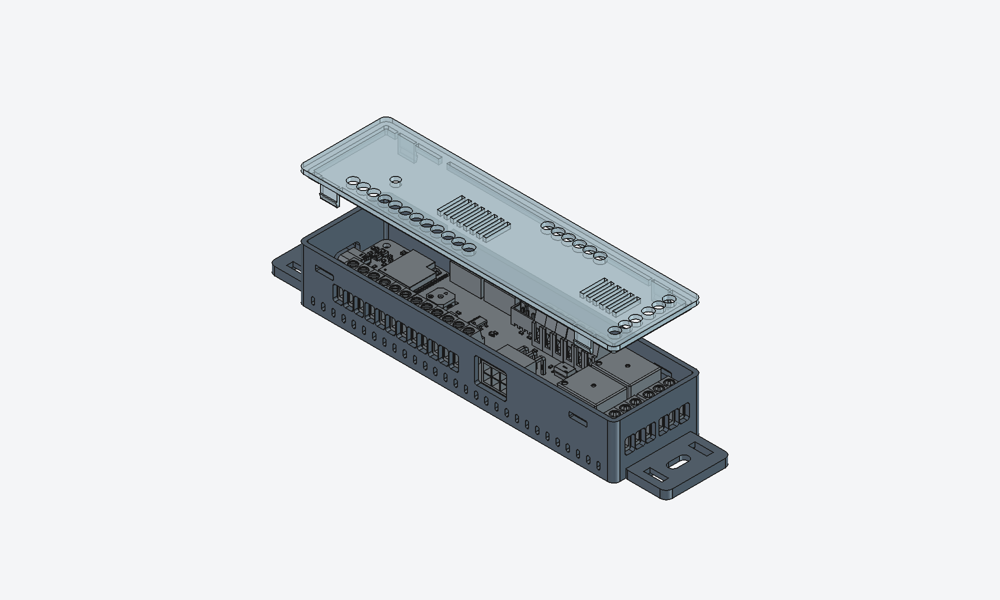

# 3D Printed Parts

This folder contains **3D printable files** used in this project.

The parts are designed to support the hardware assembly, protection, and mounting of the boards and modules into vending machines.

---

## 📁 Folder Structure

Each subfolder should represent a **single printed part** and contain:

- **STL files** (`.stl`) – ready for slicing and printing  
- **STEP files** (`.step`) – editable CAD source (if available)  
- **README.md** – optional notes specific to the part (orientation, tolerances, etc.)

## MDB-Slave
Within the [mdb-slave](mdb-slave) folder.

Designed with Fusion360

## MDB-Slave WROOM-1U
Within the [mdb-slave-wroom-u1](mdb-slave-wroom-u1) folder, for the `mdb_slave_esp32s3-wroom-1u` board.

Generated with FreeCAD from the board STEP export. Two variants:
- [screw-clips](mdb-slave-wroom-u1/screw-clips): lid held by clips, plus optional M2.5 screws.
- [clips](mdb-slave-wroom-u1/clips): lid held by clips only.

